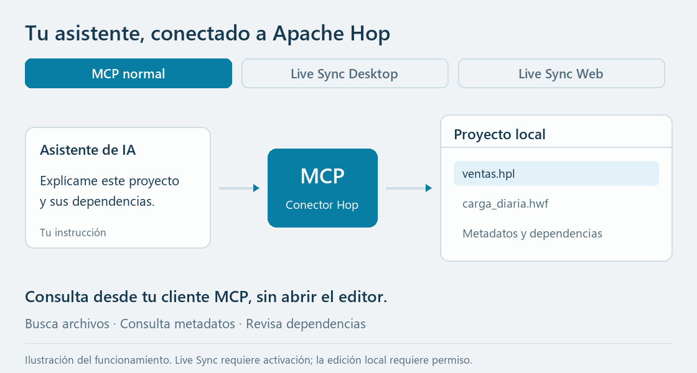

# MCP Connector for Apache Hop

[English](README.md) | **Español**

Conecta tu asistente de IA con Apache Hop para entender proyectos,
crear pipelines y workflows, y trabajar en el editor que ya conoces.

**Apache Hop 2.20.x · Java 21 · Plugin nativo**

[Descargar](https://github.com/michaaels/hop-mcp-connector/releases/latest)
· [Instalación](#instalación)
· [Novedades](RELEASE_NOTES.md)
· [Documentación](#documentación)

<picture>
  <source media="(prefers-reduced-motion: reduce)" srcset="docs/images/mcp-demo.png">
  
</picture>

*Ilustración animada de los tres modos de uso.*
[Ver imagen estática](docs/images/mcp-demo.png).

## Qué puedes hacer

- **Entender un proyecto.** Buscar archivos, explicar flujos, consultar
  metadatos y ver dependencias e impacto de los cambios.
- **Crear y modificar flujos.** Añadir componentes, conectar pasos,
  configurar propiedades compatibles y ordenar el lienzo automáticamente.
- **Trabajar a la vista.** Abrir los cambios en Hop y seguir su construcción
  guiada, con pausa, velocidad ajustable y aplicación instantánea.
- **Revisar y diagnosticar.** Validar la estructura y, con los permisos
  correspondientes, ejecutar flujos locales y consultar estados y logs.
- **Revisar antes de guardar.** Previsualizar cambios y disponer de copias
  protegidas y rollback para las modificaciones aplicadas.

## Tres formas de usarlo

| Modo | Qué te ofrece | Cómo empezar |
| --- | --- | --- |
| **MCP normal** | Trabaja sobre un proyecto local desde tu cliente MCP, sin abrir el editor. Consulta por defecto; edición y ejecución opcionales. | `hop mcp --root <proyecto>` |
| **Live Sync Desktop** | Abre o actualiza los flujos en Hop Desktop y muestra la construcción guiada en su editor nativo. | Activa **Herramientas → MCP Live Sync** y conecta el MCP local al mismo proyecto. Para editar, añade `--allow-mutation`. |
| **Live Sync Web** | Trabaja en el proyecto de una sesión de Hop Web desde su URL, sin compartir carpetas con el agente. | Activa **MCP Live Sync** en Hop Web y usa el perfil `--remote-ui` o un cliente MCP compatible con HTTPS. |

La conexión Web usa Streamable HTTP sobre HTTPS. Activar Live Sync
permite consultar y editar el proyecto de esa sesión. La ejecución de ETL y las comprobaciones profundas permanecen
deshabilitadas. Si hay varias sesiones, el agente solicita cuál utilizar.

[Guía de Desktop y construcción guiada](docs/guided-desktop-authoring.md)
· [Guía de conexión Web](docs/remote-hop-web.md)

## Pídeselo al agente

> Explícame este workflow y qué pipelines dependen de él.

> Crea un pipeline para leer un CSV, seleccionar sus campos y guardar
> el resultado. Muéstrame la construcción en Hop.

> Revisa los cambios antes de aplicarlos y ordena el lienzo.

> Conéctate a Hop Web en https://hop.example.org/hop_web/ui.

Las funciones disponibles dependen de los plugins instalados en Hop,
las propiedades que exponen y los permisos habilitados.

## Instalación

Necesitas **Apache Hop 2.20.x**, **Java 21** y un cliente compatible con MCP.

1. Descarga `hop-mcp-connector-2.4.0.zip` desde
   [Releases](https://github.com/michaaels/hop-mcp-connector/releases/latest).
2. Cierra Hop y el proceso MCP. En Web, detén Tomcat antes de sustituir
   el plugin. Extrae el ZIP en la raíz de la instalación de Hop:
   quedará en `plugins/misc/hop-mcp-connector/`.
3. Reinicia Hop y registra el comando en tu cliente MCP.

Para consultar un proyecto local:

```sh
hop mcp --root /ruta/al/proyecto
```

Para permitir crear y modificar sus flujos:

```sh
hop mcp --root /ruta/al/proyecto --allow-mutation
```

En Windows utiliza `C:\hop\hop.bat`; en Linux, `/opt/hop/hop.sh`.
El cliente debe iniciar el proceso y comunicarse por STDIO.

<details>
<summary>Ejemplo de configuración de un cliente MCP en Windows</summary>

Sustituye las rutas por tu instalación y tu proyecto. El ejemplo habilita
consulta; añade `--allow-mutation` a `args` para permitir edición.

```json
{
  "mcpServers": {
    "apache-hop": {
      "command": "C:\\Windows\\System32\\cmd.exe",
      "args": [
        "/d", "/c", "C:\\hop\\hop.bat", "mcp",
        "--root", "C:\\proyectos\\mi-proyecto"
      ]
    }
  }
}
```

Para el agente remoto de Hop Web, registra otro servidor con los argumentos
`mcp --remote-ui`, sin `--root` ni permisos locales. Instala también el
plugin en el Hop del servidor Web. Consulta la
[guía Web](docs/remote-hop-web.md) para HTTPS y configuración completa.

</details>

## Tú decides los permisos

El MCP local comienza en modo de consulta. Habilita solo lo que necesites:

| Opción local | Permite |
| --- | --- |
| `--allow-mutation` | Crear y editar pipelines y workflows. |
| `--allow-execution` | Ejecutar flujos y consultar su ejecución. |
| `--allow-deep-check` | Comprobaciones nativas que pueden contactar sistemas externos. |

Los cambios usan los objetos nativos de Hop, con vista previa, comprobación
de versión del archivo, recarga y rollback. Live Sync protege las pestañas
con cambios sin guardar. Las lecturas y respuestas tienen límites y
ocultan valores sensibles reconocidos.

## Documentación

[Referencia técnica y herramientas](docs/reference.md)
· [Live Sync y su indicador](docs/live-sync-indicator.md)
· [Sesiones Web](docs/web-agent-sessions.md)
· [Cobertura de Hop 2.20 y límites](docs/hop-2.20-coverage-2026-11-13.md)
· [Historial](CHANGELOG.md)
· [Seguridad](SECURITY.md)

Para compilar desde el código fuente: `mvn -B clean verify` con Java 21.

Proyecto independiente de la Apache Software Foundation.
Apache Hop y Apache son marcas de la ASF; su mención indica compatibilidad.
Licencia [Apache 2.0](LICENSE). Consulta los [avisos y atribuciones](NOTICE).
