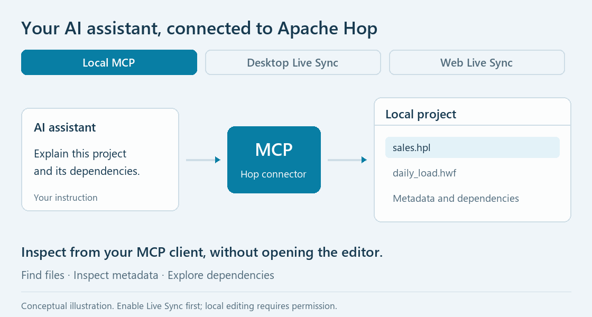

# MCP Connector for Apache Hop

**English** | [Español](README.es.md)

Connect your AI assistant to Apache Hop to understand projects,
create pipelines and workflows, and work in the editor you already know.

**Apache Hop 2.20.x · Java 21 · Native plugin**

[Download](https://github.com/michaaels/hop-mcp-connector/releases/latest)
· [Installation](#installation)
· [What's new](RELEASE_NOTES.md)
· [Documentation](#documentation)

<picture>
  <source media="(prefers-reduced-motion: reduce)" srcset="docs/images/mcp-demo-en.png">
  
</picture>

*An animated illustration of the three ways to connect.*
[View static image](docs/images/mcp-demo-en.png).

## What you can do

- **Understand a project.** Find files, explain flows, inspect metadata,
  and explore dependencies and the impact of changes.
- **Create and edit flows.** Add components, connect steps, configure
  supported properties, and arrange the canvas automatically.
- **Watch changes take shape.** Open changes in Hop and follow guided
  construction, with pause, adjustable speed, and instant application.
- **Review and diagnose.** Validate flow structure and, with the required
  permissions, run local flows and inspect execution status and logs.
- **Review before saving.** Preview changes and use protected backups
  and rollback for applied modifications.

## Three ways to connect

| Mode | What it offers | Get started |
| --- | --- | --- |
| **Local MCP** | Work on a local project from your MCP client without opening the editor. Inspection by default; editing and execution are optional. | `hop mcp --root <project>` |
| **Desktop Live Sync** | Open or refresh flows in Hop Desktop and follow guided construction in its native editor. | Enable **Tools → MCP Live Sync** and connect local MCP to the same project. Add `--allow-mutation` to edit. |
| **Web Live Sync** | Work on a Hop Web session's project by URL, without sharing folders with the agent. | Enable **MCP Live Sync** in Hop Web and use the `--remote-ui` profile or an HTTPS-capable MCP client. |

The Web connection uses Streamable HTTP over HTTPS. Enabling Live Sync
allows inspection and editing of that session's project. ETL execution
and deep checks stay disabled. If multiple sessions are available, the
agent asks which one to use.

[Desktop and guided construction](docs/guided-desktop-authoring.md)
· [Web connection guide](docs/remote-hop-web.md)

## Ask your agent

> Explain this workflow and which pipelines depend on it.

> Create a pipeline to read a CSV, select its fields, and save the result.
> Show me the construction in Hop.

> Review the changes before applying them and arrange the canvas.

> Connect to Hop Web at https://hop.example.org/hop_web/ui.

Available features depend on the plugins installed in Hop, the properties
they expose, and the permissions you enable.

## Installation

You need **Apache Hop 2.20.x**, **Java 21**, and an MCP-compatible client.

1. Download `hop-mcp-connector-2.4.0.zip` from
   [Releases](https://github.com/michaaels/hop-mcp-connector/releases/latest).
2. Close Hop and the MCP process. For Web, stop Tomcat before replacing
   the plugin. Extract the ZIP into your Hop installation root:
   it will create `plugins/misc/hop-mcp-connector/`.
3. Restart Hop and register the command in your MCP client.

To inspect a local project:

```sh
hop mcp --root /path/to/project
```

To allow creating and editing flows:

```sh
hop mcp --root /path/to/project --allow-mutation
```

On Windows, use `C:\hop\hop.bat`; on Linux, `/opt/hop/hop.sh`.
The client must start the process and communicate over STDIO.

<details>
<summary>Example MCP client configuration on Windows</summary>

Replace the paths with your installation and project. This example enables
inspection; add `--allow-mutation` to `args` to allow editing.

```json
{
  "mcpServers": {
    "apache-hop": {
      "command": "C:\\Windows\\System32\\cmd.exe",
      "args": [
        "/d", "/c", "C:\\hop\\hop.bat", "mcp",
        "--root", "C:\\projects\\my-project"
      ]
    }
  }
}
```

For the remote Hop Web agent, register another server with the arguments
`mcp --remote-ui`, without `--root` or local permission flags. Also install
the plugin in the Web server's Hop installation. See the
[Web guide](docs/remote-hop-web.md) for HTTPS and complete configuration.

</details>

## You control the permissions

Local MCP starts with inspection enabled. Allow only what you need:

| Local option | Allows |
| --- | --- |
| `--allow-mutation` | Create and edit pipelines and workflows. |
| `--allow-execution` | Run flows and inspect their execution. |
| `--allow-deep-check` | Native checks that may contact external systems. |

Changes use Hop's native objects, with preview, file-version checks,
reload, and rollback. Live Sync protects tabs with unsaved changes.
Reads and responses are bounded and redact recognized sensitive values.

## Documentation

Some detailed guides are currently available in Spanish.

[Technical reference and tools](docs/reference.md)
· [Live Sync indicator](docs/live-sync-indicator.md)
· [Web sessions](docs/web-agent-sessions.md)
· [Hop 2.20 coverage and limits](docs/hop-2.20-coverage-2026-11-13.md)
· [Changelog](CHANGELOG.md)
· [Security](SECURITY.md)

Build from source with Java 21: `mvn -B clean verify`.

An independent project, unaffiliated with the Apache Software Foundation.
Apache Hop and Apache are ASF trademarks; their use indicates compatibility.
Licensed under [Apache 2.0](LICENSE). See [notices and attribution](NOTICE).
